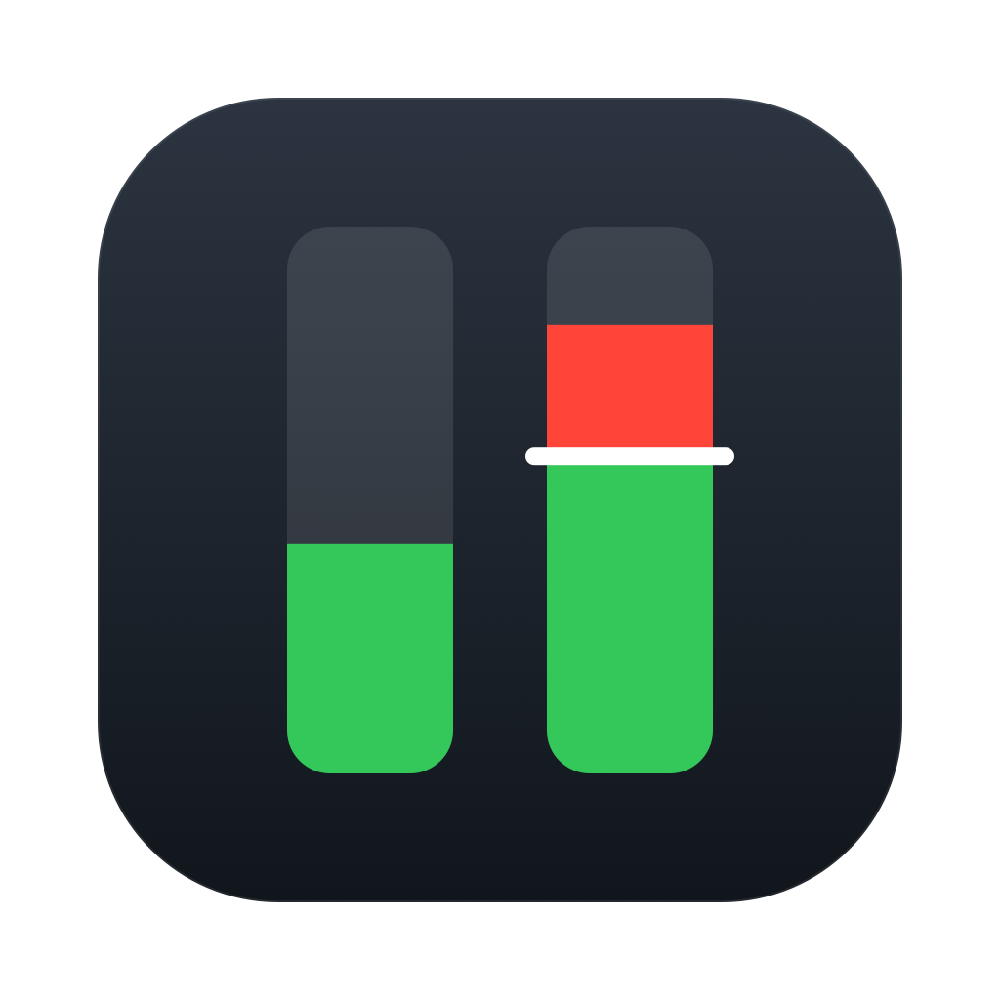

<p align="center"></p>

# LimitBar

A tiny native macOS menu bar app that shows how much of your **Claude Code**, **Codex** and
**Grok** subscription limits you have used — and whether you are burning through them faster
than the reset allows.

- **Menu bar:** one mini bar per provider (C / X / G), filled to its most-used limit (dimmed when the
  last refresh failed and the value is stale). Monochrome, so it fits light and dark menu bars like the system battery icon.
- **Popover:** every limit window with a progress bar, percent, time to reset and plan.
- **Pace tick:** each bar has a tick where an even pace would be right now. Usage past the tick is
  drawn red and labelled "over pace"; short of it is "spare". Weekly (and longer) windows spread
  the budget over 6/7 of their length (6 of 7 days), leaving a day of buffer; shorter windows such
  as 5h use their full length.

It reuses the logins the official CLIs already store, so there is nothing to configure: if
`claude`, `codex` or `grok` works in your terminal, LimitBar can read its limits.

## Requirements

- macOS 14 or later
- A Swift 6 toolchain (Xcode or the Command Line Tools) to build it
- Any of the CLIs signed in with a subscription: [Claude Code](https://docs.anthropic.com/en/docs/claude-code),
  [Codex](https://github.com/openai/codex), [Grok](https://x.ai/cli)

## Build and install

```sh
git clone https://github.com/CoderAI-dev/limitbar.git
cd limitbar
scripts/build-app.sh --install   # builds, ad-hoc signs, copies to ~/Applications and opens it
```

`scripts/build-app.sh` alone only builds `build/LimitBar.app`. Turn on "Launch at login" from the
popover. Run the unit tests with `swift test`. The icon is rendered by `scripts/make-icon.swift`.

## How it works

| Provider | Credentials (read-only) | Endpoint |
|----------|-------------------------|----------|
| Claude | Keychain item `Claude Code-credentials`, read through `/usr/bin/security` | `GET https://api.anthropic.com/api/oauth/usage` |
| Codex | `~/.codex/auth.json` | `GET https://chatgpt.com/backend-api/wham/usage` |
| Grok | `~/.grok/auth.json` | `GET https://cli-chat-proxy.grok.com/v1/billing?format=credits` |

Data refreshes every 5 minutes, when the popover opens (if older than 60 s), and on demand.

**Token policy.** LimitBar only reads the tokens the CLIs already store and sends each one only
to its own provider. It never refreshes, writes, logs or displays them, and it has no server or
telemetry of its own. When a token has expired, the popover asks you to run that CLI once, which
refreshes it.

## Limitations

- These are undocumented endpoints used by the CLIs themselves; they can change without notice.
- LimitBar does not refresh expired sessions; run the CLI to refresh them.
- The Claude keychain read relies on `/usr/bin/security` being on the item's access list, which
  it is for Claude Code's own login. On first use macOS may still ask you to allow it;
  if the prompt goes unanswered for 2 minutes the read is cancelled and retried on the next refresh.

## Disclaimer

LimitBar is an independent open-source project. It is not affiliated with or endorsed by
Anthropic, OpenAI or xAI. Use it at your own risk and in line with each provider's terms.

## License

[MIT](LICENSE) © Coder AI
