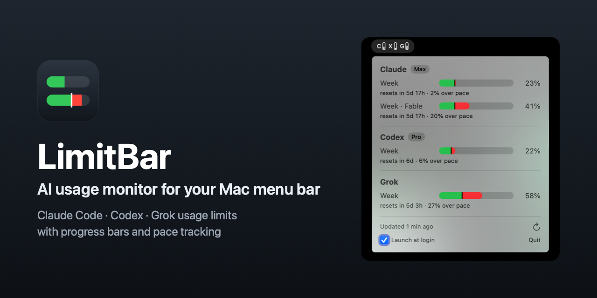
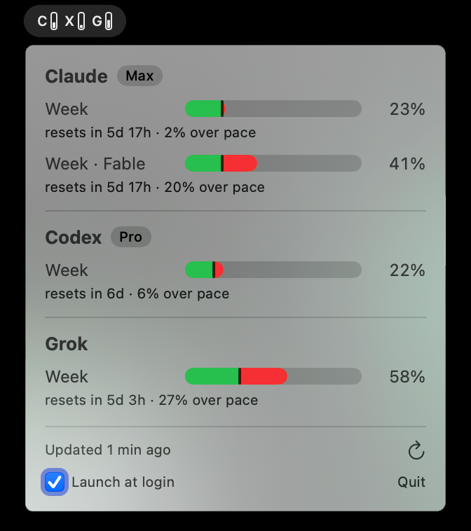

<p align="center"></p>

<p align="center">Track Claude Code, OpenAI Codex, Grok and Google Antigravity usage limits with live progress bars —
and see at a glance whether you are on pace or about to hit the limit before the reset.</p>

<p align="center">
  <a href="LICENSE"></a>
  
  
</p>

If you pay for Claude Max/Pro, ChatGPT Pro/Plus (Codex) or SuperGrok, your coding agents run on
**5-hour and weekly usage limits**. Running out mid-task is painful, and checking `/usage` or
`/status` in three different CLIs is tedious. LimitBar puts every limit in one place, refreshes it
automatically, and tells you how fast you are burning through your quota so you can pace your
usage across the week instead of getting rate-limited on day five.

## Features

- **All your AI subscriptions in one menu bar icon** — one mini progress bar per provider
  (C = Claude, X = Codex, G = Grok, A = Antigravity), filled to its most-used limit. Monochrome like the system
  battery icon; dimmed when the data is stale. Providers you are not signed in to are hidden.
- **Every limit window** — 5-hour session limits, weekly limits and per-model limits (e.g. Claude
  weekly limits for a specific model), each with a progress bar, percent used, time until reset
  and your plan.
- **Pace tracking / burn rate** — each bar has a tick showing where an even pace would be right
  now. Usage past the tick turns **red** and is labelled "over pace"; below it you see how much is
  "spare". Windows of a week or longer (weekly limits, Grok's monthly period) are budgeted over
  6/7 of their length — 6 of 7 days for a week — leaving a buffer; shorter windows such as 5h use
  their full length.
- **Zero configuration** — reuses the logins of the official `claude`, `codex`, `grok` and `agy` CLIs. If
  the CLI works in your terminal, LimitBar can read its limits. No API keys, no accounts.
- **Private by design** — talks only to each provider's own endpoint, never refreshes, stores, logs
  or uploads your tokens. No server, no telemetry, no analytics.
- **Native and tiny** — SwiftUI, no dependencies, under ~1,000 lines of code you can audit in
  minutes. Auto-refresh every 5 minutes, launch at login.

<p align="center"></p>

## Supported providers

| Provider | Sign-in it reuses | Limits shown |
|----------|-------------------|--------------|
| **Claude Code** (Anthropic) | `claude` CLI with a Claude subscription (Pro / Max) | 5-hour session, weekly, weekly per model |
| **Codex** (OpenAI) | `codex` CLI signed in with ChatGPT | 5-hour, weekly |
| **Grok** (xAI) | `grok` CLI | weekly / monthly credit usage |
| **Antigravity** (Google) | `agy` CLI signed in with Google | Gemini weekly limit (plus 5-hour when close to the limit) |

Providers whose CLI is not signed in are hidden from the menu bar and the popover, and appear
automatically after you sign in (Claude Code used without a subscription login and Codex used with
an API key count as not signed in). If none is signed in, all four are shown with a sign-in hint.

## Requirements

- macOS 14 or later
- A Swift 6 toolchain (Xcode or the Command Line Tools) to build it
- Any of the CLIs signed in with a subscription: [Claude Code](https://docs.anthropic.com/en/docs/claude-code),
  [Codex](https://github.com/openai/codex), [Grok](https://x.ai/cli)

## Build and install

```sh
git clone https://github.com/CoderAI-dev/limitbar.git
cd limitbar
scripts/build-app.sh --install   # builds, ad-hoc signs, copies to ~/Applications and opens it
```

`scripts/build-app.sh` alone only builds `build/LimitBar.app`. The app is ad-hoc signed with the
Hardened Runtime; because you build it yourself it is not quarantined, so Gatekeeper does not block
it. (A prebuilt download would need a Developer ID signature and notarization, which this project
does not provide.) Turn on "Launch at login" from the
popover. Run the unit tests with `swift test`. The icon is rendered by `scripts/make-icon.swift` and the GitHub social preview
(`docs/social-preview.png`) by `scripts/make-social-preview.swift`.

## How it works

| Provider | Credentials (read-only) | Endpoint |
|----------|-------------------------|----------|
| Claude | Keychain item `Claude Code-credentials`, read through `/usr/bin/security` | `GET https://api.anthropic.com/api/oauth/usage` |
| Codex | `~/.codex/auth.json` | `GET https://chatgpt.com/backend-api/wham/usage` |
| Grok | `~/.grok/auth.json` | `GET https://cli-chat-proxy.grok.com/v1/billing?format=credits`, `v1/settings` |
| Antigravity | Keychain item `gemini` / `antigravity`, read through `/usr/bin/security` | `POST https://daily-cloudcode-pa.googleapis.com/v1internal:loadCodeAssist`, `v1internal:retrieveUserQuotaSummary` |

Data refreshes every 5 minutes, when the popover opens (if older than 60 s), and on demand.

**Token policy.** LimitBar only reads the tokens the CLIs already store and sends each one only
to its own provider (redirects are refused, so no header ever leaves the provider's host). It never refreshes, writes, logs or displays them, and it has no server or
telemetry of its own. When a token has expired, the popover asks you to run that CLI once, which
refreshes it; then click the retry icon next to the message to update right away.

Credential files must be regular files of at most 1 MiB; symlinks and special files (including
FIFOs) are rejected.

## FAQ

**How do I check my Claude Code usage limit?**
Inside Claude Code you can run `/usage`; LimitBar shows the same 5-hour and weekly limits
permanently in the menu bar, with time to reset.

**How do I see my Codex (ChatGPT) rate limits?**
LimitBar reads the same usage data `codex` uses for `/status` and shows the 5-hour and weekly
windows as progress bars.

**Can I see Grok CLI usage outside the TUI?**
Yes. `grok usage` from a shell often prints "can't show your plan's usage here yet"; LimitBar
reads the plan's credit usage directly and keeps it visible.

**Will I run out before the reset?**
The pace tick answers that: if the bar is past the tick (red part), you are using the limit
faster than an even pace over the window; if it is short of the tick, you have spare quota.

**Does it need an API key or cost anything?**
No. It uses your existing subscription logins and makes one small read-only request per provider
every 5 minutes.

## Limitations

- These are undocumented endpoints used by the CLIs themselves; they can change without notice.
- LimitBar does not refresh expired sessions; run the CLI to refresh them.
- Only the default credential locations are read (`~/.codex/auth.json`, `~/.grok/auth.json`); a
  relocated CLI home such as `CODEX_HOME` is not followed, and a symlinked auth file is rejected.
- The Claude keychain read relies on `/usr/bin/security` being on the item's access list, which
  it is for Claude Code's own login. On first use macOS may still ask you to allow it;
  if the prompt goes unanswered for 2 minutes the read is cancelled and retried on the next refresh.

## Disclaimer

LimitBar is an independent open-source project. It is not affiliated with or endorsed by
Anthropic, OpenAI or xAI. Use it at your own risk and in line with each provider's terms.

## License

[MIT](LICENSE) © Coder AI
